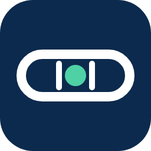
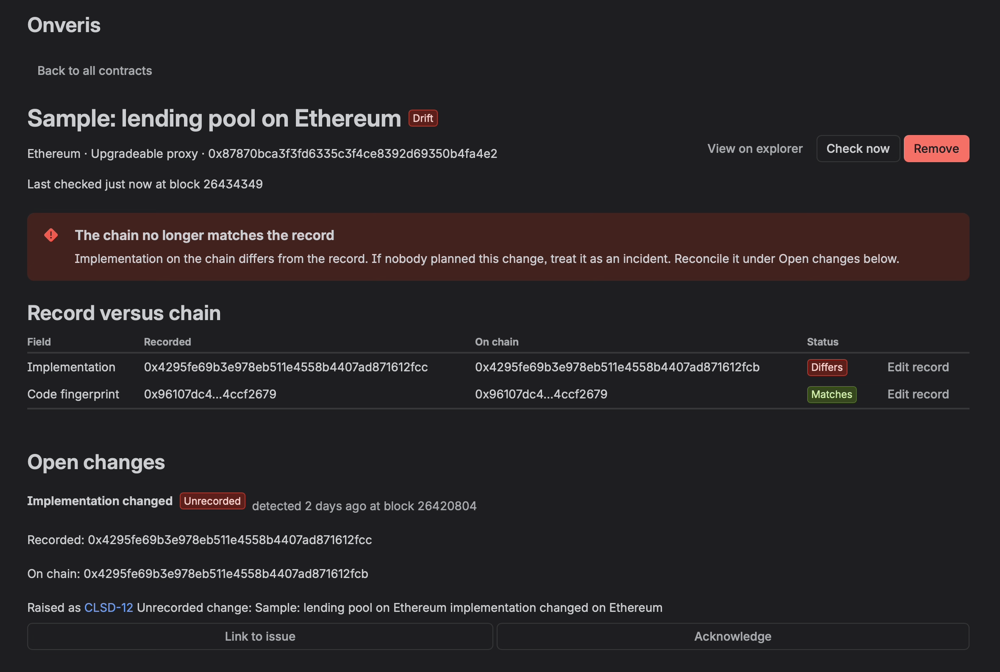
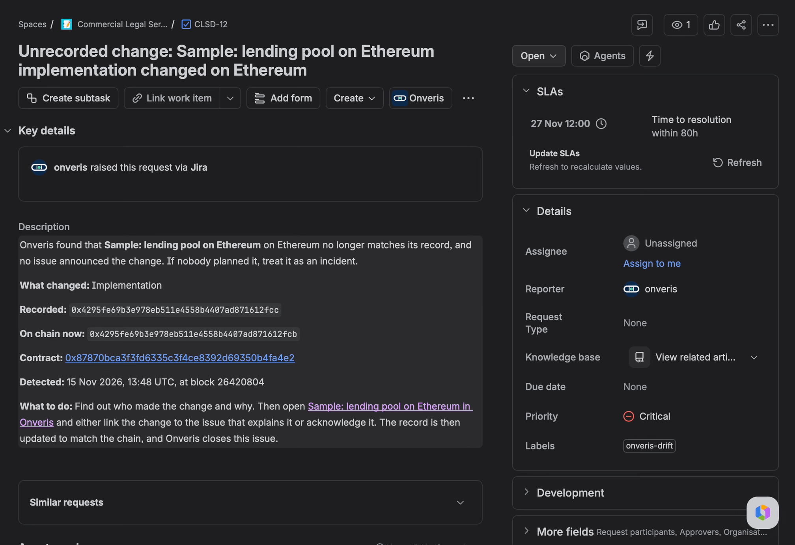
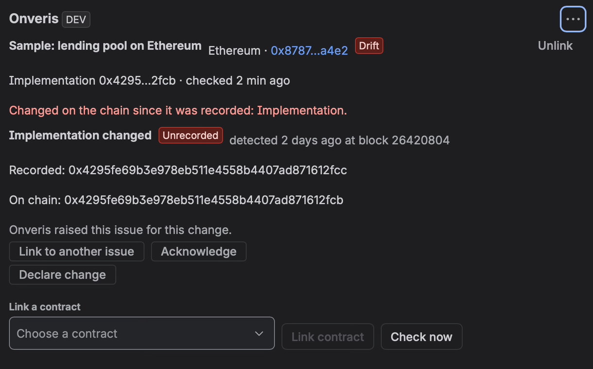
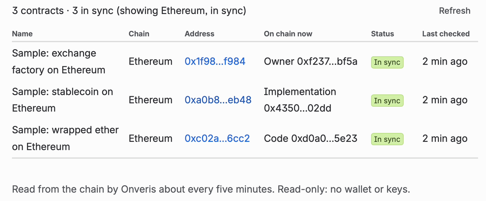
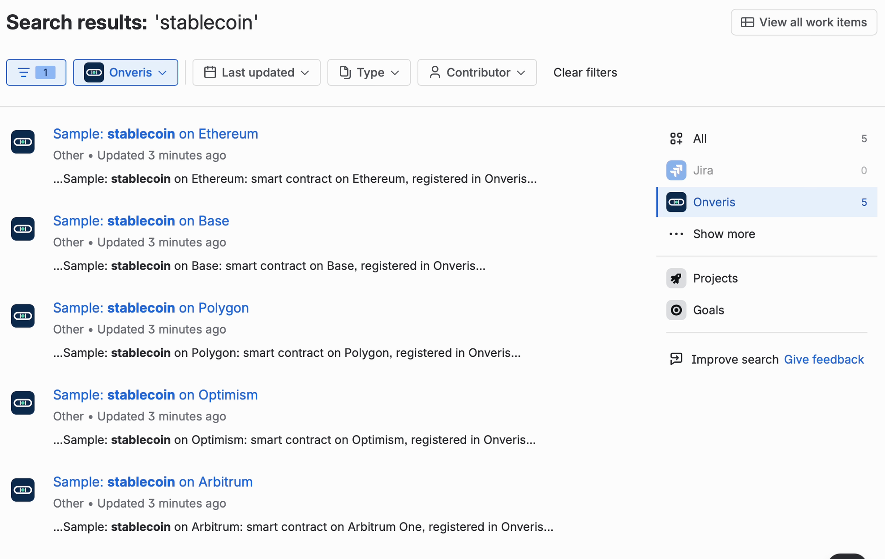
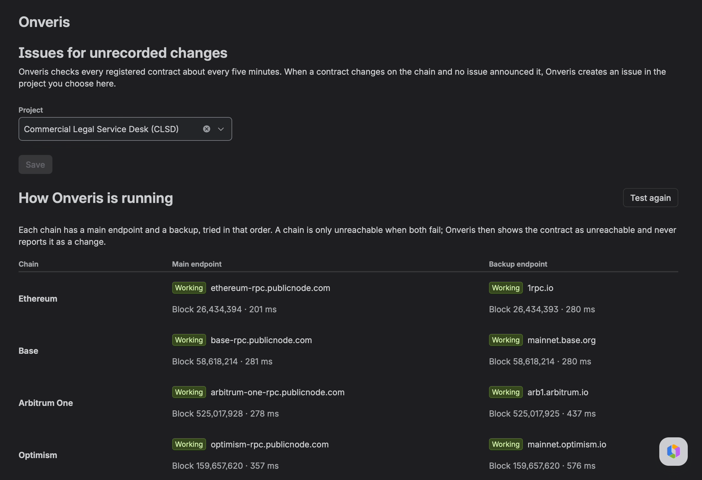
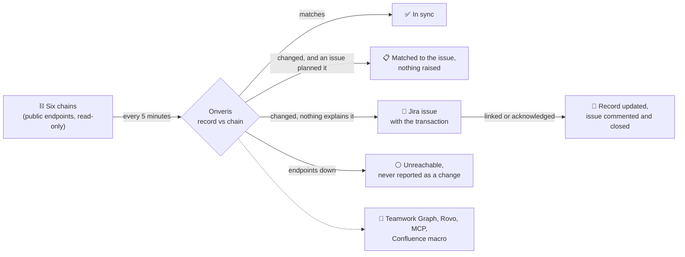

<p align="center">
  
</p>

<h1 align="center">Onveris</h1>

<h3 align="center">One stolen key can quietly swap the code of a smart contract that holds millions.<br>Onveris watches your team's contracts on the blockchain, and when one changes<br>with no Jira ticket to explain it, Onveris raises the issue within minutes.</h3>

<p align="center">
  <a href="https://youtu.be/lSi9R7HcfF0"></a>
  <a href="#-try-it-on-your-site"></a>
  <a href="#-see-it-in-5-minutes"></a>
  <a href="#-proof"></a>
  <a href="skills/onveris/SKILL.md"></a>
</p>

<p align="center">
  <a href="https://developer.atlassian.com/platform/forge/"></a>
  <a href="#-built-on-atlassian"></a>
  <a href="#-built-on-atlassian"></a>
  <a href="skills/onveris/SKILL.md"></a>
  <a href="#-built-on-atlassian"></a>
  <a href="#%EF%B8%8F-how-it-works"></a>
  <a href="#-privacy-and-limits"></a>
  <a href="#-proof"></a>
  <a href="LICENSE"></a>
</p>

<p align="center">
  <a href="#-see-it-in-5-minutes">See it</a> ·
  <a href="#-the-problem">The problem</a> ·
  <a href="#%EF%B8%8F-how-it-works">How it works</a> ·
  <a href="#-built-on-atlassian">Built on Atlassian</a> ·
  <a href="#%EF%B8%8F-built-not-to-cry-wolf">Not crying wolf</a> ·
  <a href="#-proof">Proof</a> ·
  <a href="#-try-it-on-your-site">Try it</a> ·
  <a href="#-roadmap">Roadmap</a> ·
  <a href="#-run-it-yourself">Run it</a>
</p>

<p align="center">
  
  <br><sub>A contract's code was swapped and no ticket explained it. Onveris shows the record next to the chain, and has already raised the Jira issue.</sub>
</p>

---

**Onveris** is an Atlassian Forge app for teams that run smart contracts. It keeps the team's record of each contract (which code it runs, who can change it, who owns it) **true to the blockchain**. Every five minutes it reads the chain. When something changed and **no Jira issue planned it**, Onveris raises one, with the before and after values and the transaction. When someone links the work that explains it, or acknowledges it with a note, Onveris updates the record and closes its issue. It only reads public data: **no keys, no wallet, no transactions.**

| ⛓ **Watches the chain** | 🎫 **Turns a change into a decision** | 🧠 **Known to people and to AI** |
|:---|:---|:---|
| Reads six chains directly: the proxy's current code, its admin, its owner and a fingerprint of the code. A failed read is never mistaken for a change. | A planned change is matched to its issue and stays quiet. An unplanned one becomes a Jira issue that closes itself once someone explains it. | A Jira issue panel, a live Confluence table, a Rovo agent, four MCP tools for any AI app, and every contract in Rovo Search, joined to its Jira issues in Teamwork Graph. |

<table>
  <tr>
    <td align="center" width="25%"><h3>6</h3><sub>chains, each read through<br>two public endpoints</sub></td>
    <td align="center" width="25%"><h3>≤ 5 min</h3><sub>from a change on chain<br>to a Jira issue</sub></td>
    <td align="center" width="25%"><h3>4</h3><sub>MCP tools, tested from<br>an outside AI app</sub></td>
    <td align="center" width="25%"><h3>112</h3><sub>automated tests,<br>all passing</sub></td>
  </tr>
</table>
<p align="center"><sub>Measured on the development site, 16–17 Nov 2026. The real upgrade behind the second number is in <a href="#-proof">Proof</a>.</sub></p>

## 📸 See it in 5 minutes

**▶️ Or watch it:** the whole loop in under two minutes, from a change on chain to a Jira issue, a planned change, Confluence and Rovo.

<p align="center"><a href="https://youtu.be/lSi9R7HcfF0"></a></p>

**1 · The issue nobody had to write.** A contract changed on chain and no ticket announced it, so Onveris raised one: what changed, recorded versus on-chain values, the contract, when it was detected, and exactly what to do. Labelled `onveris-drift` and reported by the Onveris app itself.

<p align="center"></p>

**2 · Decide right on the issue.** The Onveris panel on any Jira issue shows the contracts it concerns and their open changes. One click: this issue explains it, link another issue, or acknowledge with a note. Or **declare a change in advance**, so Onveris stays quiet when it lands.

<p align="center"></p>

**3 · Deployment docs that can't go stale.** A Confluence macro puts a live table of the registered contracts on any page, filtered by chain and status.

<p align="center"></p>

**4 · Findable in Rovo Search.** Every registered contract is sent to Teamwork Graph and kept in step every 30 minutes, removals included. Each one carries the Jira issues linked to it.

<p align="center"></p>

**5 · Honest about its own health.** The settings page picks the Jira project for drift issues and tests every chain endpoint live, plus the automatic check, Confluence, Teamwork Graph and Rovo.

<p align="center"></p>

## 🧩 The problem

Many smart contracts that hold real money are **upgradeable**: whoever holds the admin key can swap the code the contract runs, or hand control to someone else. There is no bug to find in an audit. One key is enough.

- 🔑 **Wasabi Protocol, April 2026.** A compromised admin key granted admin roles and upgraded core contracts on four chains. Over $5 million lost ([The Block](https://theblock.co/post/399558/wasabi-protocol-hit-by-more-than-5-million-exploit-across-multiple-chains-security-firms-say)).
- 🔑 **Conduit, April 2026.** A compromised admin account pushed a malicious proxy upgrade to a USDC gateway on Arbitrum. About $6.6 million reported lost ([Onchain Diary](https://theonchaindiary.com/articles/proxy-upgrade-attacks-explained/)).
- 🔑 **Humanity Protocol, June 2026.** Admin keys reportedly taken from a team member's laptop; the bridge was upgraded to a malicious implementation ([report](https://www.vibraniumaudits.com/post/humanity-protocol-hack-36m-private-key-exploit)).
- 🕳 **Kinto, July 2025.** Backdoored proxies sat unnoticed for months, then were upgraded and used to mint tokens ([OWASP](https://scs.owasp.org/sctop10/SC10-ProxyAndUpgradeabilityVulnerabilities/)).

In 2026 OWASP added **Proxy & Upgradeability** to its Smart Contract Top 10, and its advice is to leave *"time allowed for review/monitoring before execution"*.

Meanwhile the team plans its upgrades in Jira, and the two drift apart. A contract changes and **no ticket records it**: that is either a broken process or an incident in progress. Addresses in docs and tickets **go stale**. And nobody can quickly answer *"what changed on our contracts this week, and was each change approved?"*

**Onveris is that monitoring, joined to the place where the team already decides things: Jira.**

## ⚙️ How it works



| | Step | What happens |
|:-:|---|---|
| 1 | **Register** | Pick a chain and paste an address. Onveris reads the contract and shows what it found before saving: whether it's an upgradeable proxy, the code it runs (implementation), its proxy admin or beacon, its owner, and a fingerprint of its code. |
| 2 | **Link the work** | Link the Jira issues that plan its changes and the Confluence pages that document it. An issue can **declare a change in advance**. |
| 3 | **Watch** | Every five minutes Onveris reads every contract again and compares it with the record. Each chain has a main and a backup endpoint; if both fail, the contract shows *Unreachable* and nothing is raised. |
| 4 | **Decide** | A difference becomes a recorded change with before and after values and, when the chain identifies it, the transaction. If a declared change matches, it's marked planned. If not, Onveris raises an issue in the project the Jira admin chose, labelled `onveris-drift`. |
| 5 | **Close the loop** | Someone links the issue that explains the change, or acknowledges it with a note. The record updates, the change moves to the contract's history, and Onveris comments on its issue and moves it to done. |

**Reading the chain** uses standard public JSON-RPC: `eth_getCode` for the fingerprint, the EIP-1967 and older OpenZeppelin storage slots for proxy details, `owner()` for the owner, and the `Upgraded`, `BeaconUpgraded`, `AdminChanged` and `OwnershipTransferred` events for the transaction. Chains: Ethereum, Base, Arbitrum One, Optimism, Polygon and the Sepolia test network. No blockchain libraries beyond a hashing package.

## 🧱 Built on Atlassian

| Module | What it does in Onveris |
|---|---|
| `jira:globalPage` | The contract registry: list, filters, contract pages, register, reconcile, history |
| `jira:issuePanel` | The contracts an issue concerns, their open changes, and one-click reconcile or declare |
| `jira:adminPage` | The project for drift issues, and a live health check of every chain endpoint and integration |
| `scheduledTrigger` | The five-minute check of every contract, oldest first, within a time budget |
| Jira REST API | Reads issues as the person looking; raises, comments on and closes drift issues as the app |
| `macro` (Confluence) | A live contracts table for deployment pages, filtered by chain and status |
| `rovo:agent` + `action` | The Onveris agent: *"Has anything changed this week?"*, *"Which contracts have unrecorded changes?"* |
| `rovo:mcp` | The same four tools for any MCP app (Claude, Cursor and others), with an open [skill file](skills/onveris/SKILL.md) that teaches agents to use them |
| `graph:connector` | Every contract as a Teamwork Graph object, kept in step by a recurring task, joined to its Jira issues, findable in Rovo Search |
| Forge storage | Contracts, changes and planned changes, with per-contract claims so two checks never record the same change twice |

## 🛡️ Built not to cry wolf

| | |
|---|---|
| **A failed read is never a change** | If a chain can't be reached, the contract shows *Unreachable* with its last known values, and nothing is raised. |
| **Never the same issue twice** | Recording a change takes a short per-contract claim in storage, so overlapping checks can't both raise it. |
| **People only see what they're allowed to** | Linked issues and pages are read as the person looking. The graph and the AI tools carry issue ids or counts, never keys or titles. |
| **Only Jira admins change what counts as true** | Registering, removing, editing the record, reconciling and declaring are checked against Jira on the server. Everyone else can look, run a check, and link issues and pages. |
| **No personal data stored** | Public chain data and links to issues and pages, and no user identifiers. |
| **Read-only on chain** | No keys, no wallet, no transactions. Only contract addresses leave Atlassian, in standard read requests. |

## 🧾 Proof

| Claim | Evidence |
|---|---|
| A real, unplanned upgrade was caught and raised in Jira | On Sepolia, a test proxy was upgraded from V1 to V2 with no ticket ([tx 0x54e4…5ca3](https://sepolia.etherscan.io/tx/0x54e4bf7165905c185e18d8924639acd75fb6e178d12a60ca3c6ef6071e535ca3)). Onveris recorded the change with that transaction and raised a Jira issue, which closed itself when the change was acknowledged. 16 Nov 2026 |
| A judge's install works from scratch | On a clean site, using the public install link, every step of the judge's guide passed, including the Confluence fallback and a change caught before any project was set. 18 Nov 2026 |
| The automatic check runs reliably | Every five minutes, all registered contracts checked with no failures, in the logs reviewed on 17 Nov 2026 |
| The MCP tools work from outside Atlassian | All four tools called from Claude Code against the live site, 17 Nov 2026 |
| Contracts are findable in Rovo Search | Searching *stablecoin* lists the samples under the Onveris source, with its logo ([screenshot](#-see-it-in-5-minutes)) |
| The full flow works in a browser | Register, check, drift issue, reconcile from the page and from an issue panel, planned change, Confluence macro, Rovo agent: tested by hand 15–16 Nov 2026 |
| The logic is tested | 112 tests (`npm test`): the comparison and decision logic, storage claims, access checks, the connector and live reads of real contracts |
| Security was reviewed | A white-box review of the Forge app; three findings fixed (commit `bc10c6c`) |

## 🧭 Try it on your site

You need a Jira Cloud site where you are a Jira admin. Confluence on the same site is optional.

1. **Install** Onveris in Jira from the install link in the Devpost submission.
2. **Load samples.** Open **Apps > Onveris** and choose **Load sample contracts**. Eight well-known public contracts on five chains are read live and appear *In sync*.
3. **Choose where issues go.** Open **Settings (⚙️) > Jira apps** and choose **Onveris** under **Apps** on the left. Pick a project and save. **How Onveris is running** tests every chain endpoint live. If you skip this, nothing is lost: a change found earlier gets its issue as soon as you pick a project.
4. **Cause a change.** Open any sample contract, choose **Edit record** on the *Proxy admin* row, change the last character and choose **Save and check**. Editing the record is exactly what the chain changing under you looks like: Onveris shows **Drift**, records the change and opens a Jira issue.
5. **Reconcile it.** Choose **Acknowledge**, add a note and confirm. The contract is back *In sync*, the change is in **History**, and the Jira issue gets a comment and is closed.
6. **Work from an issue.** Open any Jira issue. In the row of small icon buttons under the title, choose the Onveris one (it has no label; hover to see its name), and link a contract.
   - **Reconcile from the issue:** repeat step 4. The panel lists the open change; choose **… explains it**.
   - **Plan ahead:** choose **Declare change**, pick **Proxy admin**, then repeat step 4. The change is recognised as planned and no issue is raised.
7. **Confluence** (optional). Connect Onveris to Confluence: [Atlassian Administration](https://admin.atlassian.com) > **Apps** > your site > **Connected apps** > **onveris** > **Connections** > connect **Confluence**. Then edit any page, type `/Onveris contracts` and publish.
8. **Rovo** (if your site has it). Open Rovo Chat, choose the **Onveris** agent and ask *"Has anything changed this week?"* To make contracts findable in Rovo Search, connect the Onveris connector on the same **Connections** tab.
9. **Any AI app over MCP** (optional). On the app's **Details** tab, under **Tools**, choose **Enable tools**. Then, for example in Claude Code:
   ```sh
   claude mcp add --transport http onveris https://mcp.atlassian.com/forge/0d7d779b-4386-4240-a63a-675969946686
   ```
   Run `/mcp`, authenticate, and ask *"Which of our contracts have unrecorded changes?"* More in the [skill file](skills/onveris/SKILL.md).

## 🗺 Roadmap

<table>
  <tr>
    <th width="33%">✅ Shipped</th>
    <th width="33%">🔜 Next</th>
    <th width="34%">🧭 Later</th>
  </tr>
  <tr valign="top">
    <td>
      • Registry with read-before-save on six chains<br>
      • Five-minute checks with endpoint failover<br>
      • Drift issues that raise, comment and close themselves<br>
      • Planned changes declared from an issue<br>
      • Issue panel, settings with live health checks<br>
      • Confluence macro<br>
      • Rovo agent and four MCP tools, with a skill file<br>
      • Teamwork Graph connector: recurring sync, removals, Jira issue links, Rovo Search
    </td>
    <td>
      • <b>What can the new code do?</b> On an upgrade, list the functions the new code added, and name the dangerous ones (mint, withdraw, change owner)<br>
      • <b>Early warning:</b> spot an upgrade scheduled in a timelock and raise the issue before it runs<br>
      • <b>Your own node provider</b> in settings, for teams that don't want public endpoints<br>
      • History from before a contract was registered (needs an archive node)
    </td>
    <td>
      • Incidents in Jira Service Management with on-call routing<br>
      • More chains, including non-EVM ones<br>
      • Multisig and governance awareness: who signed the upgrade<br>
      • Atlassian Marketplace listing
    </td>
  </tr>
</table>

## 🛠 Run it yourself

This repository is the Forge app: [`manifest.yml`](manifest.yml), [`src/`](src/) and [`test/`](test/), plus [`skills/onveris/SKILL.md`](skills/onveris/SKILL.md) for third-party AI agents. Needs Node.js 24 and the [Forge CLI](https://developer.atlassian.com/platform/forge/getting-started/).

```sh
npm install
npm test          # 112 tests; the reader tests read live public chains
npm run lint
forge deploy -e development
forge install     # pick your Jira site
```

[DEVELOPMENT.md](DEVELOPMENT.md) covers modules, permissions, the code layout and how to run each part.

## 🔐 Privacy and limits

| | |
|---|---|
| Data that leaves Atlassian | Only contract addresses, in standard read requests to public blockchain endpoints. Nothing from Jira or Confluence. Full policy: [PRIVACY.md](PRIVACY.md) |
| Endpoints | Free public endpoints, so no keys or sign-up. The first choice on every chain is [PublicNode](https://www.publicnode.com/terms); the backups run on a best-effort basis. A team using Onveris for real would use its own node provider |
| Detection, not prevention | Onveris notices a change within about five minutes and puts it in front of a named owner. It does not stop a transaction or recover funds; its value is the time it buys when the team has a pause switch or a timelock |
| History | Onveris knows the changes it has seen since a contract was registered; older history isn't available from free public endpoints |
| Chains | EVM chains only for now |

## 📄 License

[MIT](LICENSE). Built for Codegeist 2026 · Category: Apps for Specialized Industries · Bonus prize entered: Teamwork Graph · also built for Rovo agents and Atlassian MCP.
